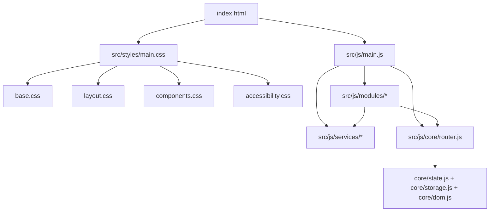
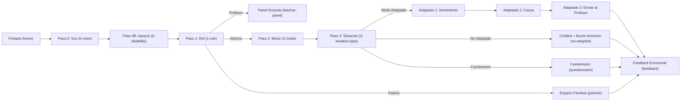

# Arquitectura de Contigo

Este documento describe la organización interna, las capas de software y el flujo de datos de **Contigo**.

## Principios de diseño

1. **Cero dependencias de ejecución:** HTML5 semántico, CSS3 modular y JavaScript nativo con ES Modules (`type="module"`).
2. **Bajo acoplamiento:** Los módulos de dominio (`src/js/modules/`) no dependen entre sí de forma circular; el enrutador (`core/router.js`) expone `registerPageHook()` para que cada vista registre su propio renderizado al activarse.
3. **Privacidad efímera:** Todos los datos de sesión se almacenan en `sessionStorage` con prefijo `contigo.` (`core/storage.js`).
4. **Resiliencia offline:** Tanto el reconocimiento de voz (`services/speech.js`) como el chatbot (`services/gemini.js`) cuentan con degradación elegante si el dispositivo carece de micrófono o clave API.

---

## Diagrama de capas

---

## Flujo de pantallas principales

---

## Responsabilidad de cada capa

| Capa | Directorio | Responsabilidad |
| --- | --- | --- |
| **Entrada** | `index.html`, `src/js/main.js` | Estructura semántica de pantallas/modales y secuencia de arranque (`bootstrap()`). |
| **Estilos** | `src/styles/` | Diseño visual, layout responsive, componentes reutilizables y modos de accesibilidad. |
| **Núcleo** | `src/js/core/` | Utilidades DOM, estado global, persistencia en sesión y navegación con gestión de foco. |
| **Servicios** | `src/js/services/` | TTS/STT del navegador, cliente Gemini + fallback local e internacionalización. |
| **Módulos** | `src/js/modules/` | Lógica de negocio e interacción de cada pantalla o herramienta transversal. |
| **Recursos** | `assets/images/` | Imágenes optimizadas fuera del HTML para mejorar rendimiento y mantenibilidad. |
