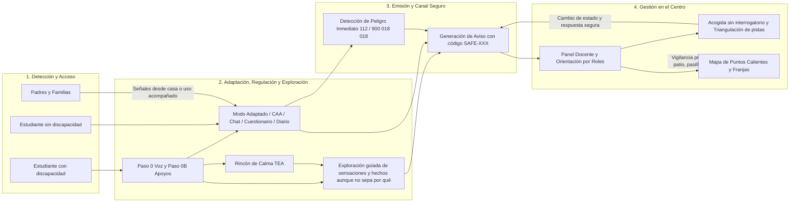
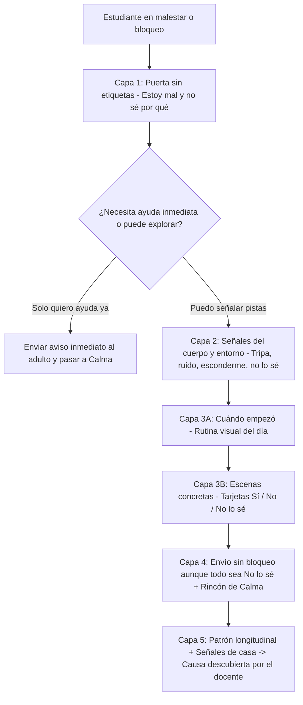

# Customer Journey y Service Blueprint — Contigo

Este documento modela la experiencia completa (*end-to-end*) de **Contigo** para los **4 actores principales** del ecosistema escolar frente a situaciones de acoso, exclusión o sobrecarga emocional.

El objetivo es doble:
1. **Fotografiar con rigor el estado actual** implementado en el prototipo estático (`index.html`, `src/js/`) para evitar suposiciones sobre lo que ya existe.
2. **Definir la evolución profesional del producto** (persistencia multi-dispositivo, seguridad, trazabilidad, descubrimiento sin *«¿por qué?»* y cierre de ciclo) para alinear diseño, desarrollo y validación con centros educativos.

---

## 1. Propósito y enfoque metodológico

**Contigo** responde al reto de prevención, detección temprana y comunicación accesible del acoso escolar, con foco especial en alumnado con **TEA (Trastorno del Espectro Autista)** y diversas necesidades de accesibilidad.

Para profesionalizar el proyecto, el modelado del *Customer Journey* adopta cuatro principios:

- **Separación explícita entre prototipo actual y producto objetivo:** cada etapa contrasta el comportamiento real hoy (datos efímeros en `sessionStorage` en un único navegador) con los requisitos de producción en un centro educativo real.
- **No exigir saber «por qué» para pedir ayuda:** un estudiante con discapacidad —por TEA, alexitimia, sobrecarga sensorial o dificultad cognitiva— frecuentemente sabe que *está mal*, pero no puede identificar ni explicar la causa; la herramienta debe reconstruir pistas concretas sin bloquearle.
- **Diseño inclusivo como eje del flujo, no como capa cosmética:** las adaptaciones sensoriales, cognitivas, auditivas, visuales, motoras y de comunicación alternativa (CAA) determinan la ruta de navegación y la carga cognitiva en cada paso.
- **Cierre de ciclo entre actores (*Closed-Loop Safety*):** ningún aviso emitido por un estudiante o familia es útil si no llega de forma segura al equipo docente adecuado y si el emisor no percibe acuse, protección y seguimiento.

---

## 2. Los 4 actores principales y subperfiles

| Actor principal | Subperfiles clave | Objetivo principal | Necesidad diferencial y barreras críticas |
| --- | --- | --- | --- |
| **1. Estudiantes con discapacidad** | Alumnado con **TEA / sensibilidad sensorial**, **baja visión / ceguera**, **sordera / hipoacusia**, **sin habla / usuario de CAA**, **discapacidad intelectual (lectura fácil)** y **discapacidad motora** (en rol de víctima, testigo o sin saber qué le ocurre). | Expresar su malestar y conseguir ayuda aunque no sepa nombrar una emoción ni explicar *por qué* está mal. | Necesita puerta sin interrogatorios («Estoy mal y no sé por qué»), señales corporales/sensoriales concretas, preguntas Sí/No/No sé sobre hechos, pictogramas ARASAAC («Voz Prestada»), voz guiada (TTS) y regulación sensorial previa. |
| **2. Estudiantes sin discapacidad** | **Víctima directa** y **Testigo (*bystander*)** que detecta agresiones, burlas o aislamiento hacia un compañero/a. | Contar lo sucedido de forma rápida, discreta y sin miedo a represalias ni exposición pública. | Valora el anonimato real, la inmediatez del chat o cuestionario, un diario privado para acumular evidencias y la **Salida Rápida (`Esc`)** si alguien se acerca a su pantalla. |
| **3. Profesores y equipo educativo** | **Tutor/a de grupo**, **Departamento de Orientación / Bienestar** y **Dirección / Coordinación de Convivencia**. | Detectar alertas tempranas (incluidas las que llegan sin causa clara), priorizar urgencias, acoger sin interrogar y prevenir puntos calientes. | Precisa acceso autenticado por rol, bandeja sincronizada entre dispositivos, pautas de acogida sin interrogatorio (esp. TEA), trazabilidad de actuaciones y analítica de franjas/zonas. |
| **4. Padres, madres y tutores legales** | **Familias que detectan señales en casa** (incluido «vuelve mal sin saber explicar por qué») y **familias que acompañan al menor** a usar la herramienta. | Trasladar al centro señales tempranas observadas en casa y triangular patrones con el equipo educativo. | Necesita un canal sencillo sin tecnicismos, registro de señales y franjas observadas desde casa, modo acompañamiento respetuoso, acuse `SAFE-XXX` y coordinación discreta. |

---

## 3. Flujo integral entre actores (Service Blueprint)

El siguiente diagrama representa el ciclo completo de detección, exploración guiada, regulación, comunicación y actuación coordinada entre los cuatro actores:

---

## 4. Customer Journey detallado por actor

### 4.1 Estudiantes con discapacidad

**Contexto emocional y barreras críticas:** Quien sufre acoso, exclusión o sobrecarga y además presenta TEA, discapacidad sensorial, cognitiva, motora o ausencia de lenguaje oral suele llegar a la aplicación en estado de bloqueo o saturación. **El obstáculo más difícil es que a menudo el propio estudiante no sabe identificar por qué está mal** (alexitimia, dificultades de interocepción, dificultad para conectar un hecho previo con el malestar actual o incapacidad de abstraer causas como «acoso social» vs. «ruido»). Si la app pregunta «¿Por qué pasa?» o le obliga a elegir una etiqueta abstracta, el estudiante se bloquea y abandona sin pedir ayuda.

| Etapa | Objetivo | Puntos de contacto | Emoción y fricciones | Estado actual en Contigo | Evolución profesional |
| --- | --- | --- | --- | --- | --- |
| **1. Descubrimiento y acceso** | Entrar al espacio seguro de forma autónoma y sin estigma. | `#screen-home`, enlace de salto `.skip-link`, selector de idioma `#lang-select`, botón **Empezar** (`0-voice`) y **Salida Rápida (`Esc`)**. | Alivio al ver a «Nube» y lenguaje amable; riesgo de que un compañero vea la pantalla o de no saber leer textos largos. | Implementado (`index.html`, `accessibility.js`). Soporta 7 idiomas incluido árabe `RTL` y Salida Rápida inmediata a apuntes de matemáticas. | Añadir acceso directo **«Estoy mal y no sé por qué»** desde portada, entrada por **códigos NaviLens / QR accesibles** en aulas/pasillos y acceso sin login complejo mediante código de centro. |
| **2. Configuración / Onboarding** | Activar los apoyos visuales, auditivos, motores o cognitivos necesarios en pocos segundos. | `#screen-0-voice` (voz Sí/No + `#btn-play-welcome-voice`), `#screen-0-disability` (6 tarjetas + atajos `1`–`6`), `#gear-modal`. | Alivio si el sistema le habla claro o silencia sonidos; fricción si debe repetir la configuración en cada sesión. | Implementado en sesión (`flow.js`, `accessibility.js`). Activa TTS, alto contraste, lectura fácil, botones grandes, sin animaciones (`.still`) y modo sordo (`#visual-alert-strip`). | Persistir perfil en dispositivo/cuenta opcional, permitir **preconfiguración por tutor/familia** y sugerir automáticamente **Modo Adaptado** o **Tablero CAA** al marcar perfiles `intelectual`, `tea` o `muda`. |
| **3. Regulación y evaluación** | Bajar el nivel de activación/bloqueo y poder expresar malestar sin saber el motivo. | `#screen-calm` (respiración guiada con `#breathing-circle`), `#screen-1-role`, `#screen-2-mode`, `#screen-3-situation-type`. | De ansiedad o bloqueo a calma; **fricción crítica**: `#screen-3-situation-type` obliga a elegir entre `Víctima`, `Testigo` o `Cuestionario`, lo que excluye a quien no sabe qué le pasa. | Implementado (`calm.js`, `flow.js`), pero orientado a etiquetas previas (`victima`/`testigo`). Ver análisis detallado en la sección `4.1.1`. | Incorporar **puerta sin etiquetas («Estoy mal y no sé por qué» / «Quiero que venga un adulto»)** y acceso inmediato a `#screen-calm` en cualquier punto del flujo sin perder avances (ver sección `4.1.1`). |
| **4. Acción principal** | Expresar qué siente en el cuerpo y reconstruir hechos concretos sin responder preguntas abstractas de «¿por qué?». | `#screen-adapted-1` (4 caras), `#screen-adapted-2` (6 causas), `#screen-adapted-3` (lugar, frases rápidas, dictado), `#screen-caa` (pictogramas ARASAAC). | **Fricción severa**: `#screen-adapted-1` solo da 4 emociones abstractas y `#screen-adapted-2` pregunta «¿Por qué pasa?» con categorías conceptuales; además `#screen-caa` fija el lugar en `'patio'`. | Parcial. El flujo Adaptado 1–3 captura sentimiento, causa y lugar; pero no contempla señales corporales, rutina del día ni tarjetas Sí/No/No lo sé, y `caa.js` hardcodea `'patio'`. | Desplegar el **modelo progresivo en 5 capas** de la sección `4.1.1` (señales corporales/sensoriales + momento de la rutina + escenas concretas `Sí / No / No lo sé` sin bloqueo) y añadir selector visual de lugar en `#screen-caa`. |
| **5. Confirmación y protección** | Saber que el mensaje llegó y poder pedir ayuda presencial sin hablar. | `#adapted-sent-confirm` (`#adapted-safe-code`), `#btn-speak-for-me`, `#caa-sent-feedback`, `#screen-feedback`. | Alivio y sensación de ser escuchado; desorientación si no entiende qué ocurre después con el código `SAFE-XXX`. | Parcial. Muestra el código `SAFE-XXX` y permite leer en voz alta el resumen (`#btn-speak-for-me`), pero solo se guarda en `sessionStorage` local y expone `#btn-adapted-to-teacher-panel`. | Enviar el aviso (con todas sus pistas o como «Sin causa definida») en tiempo real al servidor del centro, retirar el acceso al Panel Docente y explicar el código `SAFE-XXX` en **Lectura Fácil**. |
| **6. Seguimiento y cierre** | Consultar si un docente ha visto el aviso y registrar episodios breves para detectar patrones ocultos. | `#screen-feedback` (4 caras, copiar/PDF), consulta futura de código `SAFE-XXX`. | Incertidumbre si tras cerrar la pestaña pierde el código y nadie conecta los episodios repetidos. | No cubierto más allá del cierre emocional de `#screen-feedback`; al cerrar el navegador se borra todo `sessionStorage`. | Habilitar **diario pictográfico ultrarrápido** (2 toques) para detectar patrones por franja/zona y consulta en Lectura Fácil + TTS mediante `SAFE-XXX`. |

#### 4.1.1 Reto central: cómo ayudar al estudiante con discapacidad cuando no sabe por qué está mal

En el diseño actual del prototipo, tres pantallas consecutivas exigen una capacidad de abstracción e introspección que a menudo **no está disponible** durante una crisis o bloqueo en alumnado con TEA, discapacidad intelectual o dificultades comunicativas:

1. `#screen-3-situation-type` pregunta *«¿Qué pasa?»* y obliga a clasificar el episodio como `1. Víctima (Me pasa a mí)`, `2. Testigo (Lo he visto)` o `3. Cuestionario`.
2. `#screen-adapted-1` pregunta *«¿Cómo te sientes ahora?»* con 4 emociones abstractas (`Tranquilo/a`, `Triste`, `Con miedo`, `Enfadado/a`).
3. `#screen-adapted-2` pregunta directamente **«¿Por qué pasa?»** ofreciendo causas conceptuales (`Social`, `Interno`, `Físico`, `Móvil / Redes`, `Patio / Ruido`, `Otra cosa`).

Cuando un chico o una chica siente un nudo en el estómago, saturación sensorial o angustia acumulada **sin saber explicar el motivo**, pedirle que elija una emoción compleja y conteste «¿por qué?» provoca bloqueo, respuestas aleatorias o abandono.

Para resolverlo de forma profesional, la evolución de **Contigo** reemplaza la pregunta directa de «¿por qué?» por un **enfoque progresivo en 5 capas** donde responder *«No lo sé»* siempre es válido y útil:

1. **Capa 1 — Puerta sin culpa ni etiquetas («Estoy mal y no sé por qué» / «Quiero que venga un adulto»):** permite pedir ayuda en 1 o 2 toques sin tener que definirse como «víctima» ni justificar si alguien le hizo algo. Si el estudiante está en bloqueo total, puede enviar el aviso de inmediato sin contestar nada más.
2. **Capa 2 — De emociones abstractas a señales corporales y sensoriales concretas (Interocepción):** en lugar de depender solo de palabras como *triste* o *enfadado*, se incorporan pictogramas físicos y conductuales fáciles de reconocer: *me duele la tripa o la cabeza*, *hay demasiado ruido o luz*, *me quiero esconder o irme*, *me late fuerte el corazón*, *no me salen las palabras*, *estoy mal y no sé por qué*.
3. **Capa 3 — Reconstrucción de hechos concretos en lugar de «¿Por qué?»:** se sustituye la pregunta causal abstracta por dos micro-pasos visuales, de una sola decisión por pantalla y con lectura TTS:
   - **3A. Cuándo de la rutina visual del día empezó:** *antes de llegar*, *en la entrada*, *en clase*, *en el recreo/patio*, *en el pasillo/baño*, *en el comedor*, *a la salida*, *no lo sé*.
   - **3B. Micro-tarjetas de una sola escena concreta con 3 botones iguales (`Sí` / `No` / `No lo sé`):** por ejemplo, *«¿Alguien se rió de ti o dijo algo feo?»*, *«¿Te quedaste solo/a o no te dejaron jugar?»*, *«¿Alguien te empujó o quitó tus cosas?»*, *«¿Había demasiado ruido o mucha gente?»*, *«¿Cambió algo de golpe en la clase o rutina?»*. **Responder «No lo sé» a todo nunca bloquea el envío.**
4. **Capa 4 — Regulación antes o mientras espera («Avisar ya y pasar al Rincón de Calma»):** tras emitir las pistas disponibles, la app acompaña al alumno hacia `#screen-calm` (o `#btn-speak-for-me` si está junto a un docente), evitando cualquier interrogatorio adicional mientras se calma.
5. **Capa 5 — Descubrimiento de la causa por patrones longitudinales y triangulación:** aunque el alumno no sepa nombrar el acoso ni identificar qué le molestó un día aislado, registrar en 2 toques *sensación + momento de la rutina* durante varios días permite que **Profesores** y **Familias** descubran la causa real (p. ej. tres episodios seguidos de dolor de tripa al empezar el patio o tras los cambios de clase en pasillos).

---

### 4.2 Estudiantes sin discapacidad

**Contexto emocional y barreras críticas:** Tanto la víctima como el testigo (*bystander*) temen que «se enteren los demás», dudan de si lo que viven es suficientemente grave para avisar y necesitan expresarse en su propio lenguaje —por texto o voz— con garantía real de anonimato o rápida reacción en caso de peligro inmediato.

| Etapa | Objetivo | Puntos de contacto | Emoción y fricciones | Estado actual en Contigo | Evolución profesional |
| --- | --- | --- | --- | --- | --- |
| **1. Descubrimiento y acceso** | Entrar rápido al canal adecuado sin atravesar pasos que sienta ajenos. | `#screen-home` (CTA secundario **Contar ahora** → `2-mode`, chips **Mi diario** y **Cuestionario**), **Salida Rápida (`Esc`)**. | Desconfianza inicial («¿esto lo va a leer alguien en mi clase?»); alivio al disponer de atajo directo y `Esc` de camuflaje. | Implementado (`index.html`, `router.js`). Puede saltar los Pasos 0 y 0B con **Contar ahora** o ir directo al cuestionario/diario. | Garantizar acceso PWA rápido, banner claro de privacidad («Nadie ve tu nombre si eliges anónimo») y protección real de vistas docentes. |
| **2. Configuración / Onboarding** | Elegir en un toque entre conversar/enviar anónimamente o responder preguntas estructuradas. | `#screen-1-role` (`alumno`), `#screen-2-mode` (`no_adaptado`), `#screen-3-situation-type` (`victima`, `testigo`, `cuestionario`). | Claridad al distinguir «Me pasa a mí» vs. «Lo he visto»; posible duda si el modo `No adaptado` suena poco acogedor. | Implementado (`flow.js`). Conecta `no_adaptado` con el chatbot (`#screen-no-adapted`) o `cuestionario` (`#screen-questionnaire`). | Clarificar etiquetas de modo (ej. «Chat y envío anónimo») y adaptar los enunciados del cuestionario específicamente para **testigos** sin redactarlos en tono de víctima. |
| **3. Regulación y evaluación** | Ordenar las ideas, comprobar la gravedad o registrar episodios previos. | `#screen-diary` (entradas cronológicas + **Analizar evolución**), prompts rápidos en `#screen-no-adapted`, `#screen-calm`. | Desahogo al ordenar fechas/lugares y detectar si la intensidad sube; duda sobre si compartir sus notas o guardarlas solo para sí. | Implementado en local (`diary.js`). Detecta repetición/escalada entre los dos últimos registros y ofrece 4 prompts iniciales en el chat. | Permitir **adjuntar de forma voluntaria** registros seleccionados del diario a un aviso anónimo o cuestionario, y proteger el diario local con PIN opcional. |
| **4. Acción principal** | Contar la situación mediante chat empático, dictado por voz, buzón anónimo o cuestionario completo. | `#screen-no-adapted` (`#form-chat`, `#btn-chat-mic`, `#anon-panel`), `#screen-questionnaire` (8 bloques + texto libre/voz). | Necesidad de sentirse comprendido sin respuestas robóticas; riesgo de exposición de datos si la IA requiere clave API en cliente. | Parcial. Chatbot funciona offline con regex empáticas o Gemini con clave propia (`gemini.js`); buzón anónimo genera `SAFE-XXX`; cuestionario detecta `danger` mostrando `#urgent-help-alert` (`112` / `900 018 018`). | Gestionar la IA conversacional desde un **proxy en backend con moderación y sin API key en el navegador**, y marcar automáticamente como **prioridad crítica** en bandeja docente los cuestionarios con `danger` o `fear`. |
| **5. Confirmación y protección** | Recibir un justificante anónimo verificable y recursos de calma o emergencia. | `#anon-confirm-msg` (`SAFE-XXX`), `#screen-feedback` (4 caras, copiar/imprimir PDF), `#urgent-help-alert`. | Sensación de descarga emocional; fricción grave si usa el cuestionario porque **no se muestra el código `SAFE-XXX`** al enviarlo. | Parcial. El envío anónimo del chat muestra `SAFE-XXX`, pero `questionnaire.js` invoca `addNotice()` sin mostrar el código devuelto al usuario y `#screen-feedback` expone enlace al Panel Profe. | Mostrar siempre el código `SAFE-XXX` tras enviar el cuestionario (con opción de copiar/guardar) y retirar el botón «Ver aviso en Panel Profe» en flujo de alumnado. |
| **6. Seguimiento y cierre** | Comprobar si el centro tomó medidas y aportar nueva información manteniendo el anonimato. | `#screen-feedback`, consulta futura de seguimiento por `SAFE-XXX`. | Temor a que el aviso quede en «saco roto» si no hay respuesta del orientador. | Pendiente. No existe buzón de respuesta ni persistencia real fuera de `sessionStorage`. | Incorporar **canal de seguimiento bidireccional anónimo** por código `SAFE-XXX` para que Orientación pueda pedir aclaraciones o confirmar medidas sin identificar al testigo o víctima. |

---

### 4.3 Profesores y equipo educativo

**Contexto emocional y barreras críticas:** El profesorado, tutores y orientadores trabajan bajo presión de tiempo y alta responsabilidad legal/protocolaria. Necesitan diferenciar ruido de urgencias reales —especialmente cuando un alumno con discapacidad comunica que está mal **sin saber explicar el motivo**—, acoger sin interrogar, coordinarse sin duplicar intervenciones y contar con evidencia objetiva para activar protocolos de convivencia.

| Etapa | Objetivo | Puntos de contacto | Emoción y fricciones | Estado actual en Contigo | Evolución profesional |
| --- | --- | --- | --- | --- | --- |
| **1. Descubrimiento y acceso** | Entrar de forma segura al entorno docente del centro educativo. | `#screen-home` (pill `Panel Profe`), `#screen-1-role` (`profesor`), `#screen-teacher-panel`. | Preocupación por la confidencialidad: hoy cualquier alumno puede abrir el Panel Profe desde portada o tras enviar un aviso. | Críticamente incompleto. El panel está abierto sin login ni separación de perfiles (`index.html`, `teacher-panel.js`). | Implementar **autenticación institucional (SSO educativo / credenciales MFA)** con control de acceso por rol (**Tutor/a**, **Orientación**, **Dirección/Convivencia**). |
| **2. Configuración / Onboarding** | Ver asignados únicamente los grupos o ámbitos que corresponden a su rol. | `#screen-teacher-panel` (actualmente sin selector de centro, curso ni usuario docente). | Sobrecarga si ve avisos que no son de su competencia o imposibilidad de recibir avisos desde dispositivos reales de alumnos. | Pendiente. Solo lee `inbox` local de `sessionStorage` más 3 casos semilla (`SAFE-104`, `SAFE-103`, `SAFE-101`). | Conectar el panel a un **backend multi-tenant por centro**, con asignación automática por destinatario (`tutor`, `guidance`, `director`) y alertas push/email configurables. |
| **3. Regulación y evaluación** | Priorizar urgencias, interpretar avisos «Sin causa definida» y comprender el contexto de accesibilidad. | `#teacher-inbox-list`, filtros (`todos`, `pendiente`, `seguimiento`, `resuelto`), `#teacher-hotspot-bars`, caja **Pauta rápida de intervención TEA**. | Tensión cuando un alumno dice «estoy mal» sin causa clara; riesgo de interrogarlo («¿por qué lloras?») y agravar su bloqueo. | Parcial. Permite filtrar por estado y ver un resumen textual agregado de lugares en `#teacher-hotspot-bars`, junto a la pauta estática TEA de 3 puntos. | Destacar prioridad (`crítica`/`alta`), mostrar pistas recogidas de un aviso **«Sin causa definida»** (señal corporal, rutina/franja, respuestas `Sí/No/No sé` y repeticiones previas) y pautas de acogida **sin interrogatorio**. |
| **4. Acción principal** | Gestionar el estado, triangular con franjas y familia, documentar actuaciones y responder de forma segura. | Selector de estado por tarjeta (`Pendiente`, `En seguimiento`, `Resuelto`), `#btn-teacher-clear-resolved`. | Frustración al no poder registrar observaciones de patio/aula ni contrastar hipótesis cuando el estudiante no supo explicar el porqué. | Básico/prototipo (`teacher-panel.js`). Cambia el estado en `sessionStorage` y limpia resueltos; incluye `#btn-teacher-seed-demo` para pruebas. | Habilitar **notas internas privadas**, cruce con señales familiares y recurrencias en la misma franja, derivación Tutor–Orientación y **respuesta adaptada hacia código `SAFE-XXX`**. |
| **5. Confirmación y protección** | Dejar constancia trazable de las medidas aplicadas y proteger la identidad de testigos/víctimas. | `#teacher-inbox-list` (persistencia de estado). | Necesidad de respaldo normativo (protocolos autonómicos de acoso y LOPIVI). | Local en `sessionStorage` únicamente (`save('panel', inbox)`). | Registrar auditoría inmutable (quién abrió, cambió estado o exportó) y ocultar identificadores sensibles según permisos del rol. |
| **6. Seguimiento y cierre** | Analizar tendencias en momentos no estructurados y cerrar expedientes con informe formal. | `#teacher-hotspot-bars` (Mapa de Puntos Calientes: patio, pasillos, clase, entrada, digital). | Satisfacción al pasar de la reacción puntual a la prevención (ej. reforzar guardias en patio/pasillos según datos). | Prototipo visual en texto plano (`counts` sobre `inbox`). | Evolucionar hacia un **Mapa de Puntos Calientes por franja horaria, rutina, curso y evolución semanal**, más **exportación de informe oficial** (PDF/CSV anonimizado). |

---

### 4.4 Padres, madres y tutores legales

**Contexto emocional y barreras críticas:** Las familias suelen llegar con preocupación, culpa o impotencia al detectar cambios en casa (negativa a ir al colegio, agotamiento/bloqueo TEA al volver, material dañado, o **regresar mal sin saber explicar qué pasó**). Temen que una denuncia genere conflicto o empeore la situación del menor, y a veces quieren usar la herramienta **junto a su hijo/a** para ayudarlo a expresarse sin forzarlo.

| Etapa | Objetivo | Puntos de contacto | Emoción y fricciones | Estado actual en Contigo | Evolución profesional |
| --- | --- | --- | --- | --- | --- |
| **1. Descubrimiento y acceso** | Encontrar un canal directo del centro para comunicar señales observadas en casa. | `#screen-home` (pill `Familias`), `#screen-1-role` (`padres`), `#screen-parents`. | Alivio al tener un canal específico sin burocracia; duda sobre quién leerá el aviso dentro del colegio. | Implementado (`index.html`, `parents.js`). Acceso directo desde portada o Paso 1. | Facilitar enlace desde la plataforma familiar del centro / web escolar con verificación ligera de familia o código de centro. |
| **2. Configuración / Onboarding** | Elegir entre avisar directamente como adulto o acompañar al hijo/a paso a paso. | `#screen-parents` (botón **Usar asistente con mi hijo/a** → `2-mode`) y ajustes `#gear-modal` si el menor necesita apoyos. | Indecisión si entra directamente como adulto y el hijo/a está al lado con sobrecarga sensorial. | Parcial. El botón `data-go="2-mode"` permite pasar al flujo del alumno, pero no pasa por `0-voice` / `0-disability` ni ofrece una guía breve para padres sobre cómo acompañar sin presionar. | Ofrecer modo **Acompañamiento familiar** (activar apoyos del menor + guía para evitar interrogarlo si no sabe por qué está mal) y marcar necesidades TEA/accesibilidad en el aviso familiar. |
| **3. Regulación y evaluación** | Identificar señales observables objetivas aunque el menor no sepa contar qué ocurrió. | `#screen-parents` (4 botones `.parent-signal-btn`: no quiere ir al cole, llega bloqueado/a, solo/a en el recreo, material roto). | Validación al ver descritas señales observables; necesidad de reflejar explícitamente el patrón **«vuelve mal sin saber explicar por qué»** y en qué días/horas se repite. | Implementado (`index.html`, `parents.js`), pero sin opción de día/franja ni de lugar real (envía siempre `place = 'patio'`). | Añadir señal explícita **«Vuelve mal sin saber explicar por qué»**, selector de **días/franja horaria** y **lugar sospechado** para triangular la causa con el colegio, más teléfono `900 018 018`. |
| **4. Acción principal** | Enviar la alerta temprana al tutor u orientación del centro. | `#form-parents` (submit **Enviar aviso al Tutor/Orientación**). | Alivio al enviarlo, pero incertidumbre si no puede elegir si va solo a Orientación o también al Tutor, o pedir cita discreta. | Parcial. Envía con destinatario fijo `'tutor_guidance'` y lugar fijo `'patio'`, navegando de inmediato a `#screen-feedback`. | Permitir elegir destinatario (`Tutor/a`, `Orientación`, `Dirección`), marcar preferencia de contacto discreto (teléfono/reunión) y garantizar envío real al backend del centro. |
| **5. Confirmación y protección** | Obtener un código de seguimiento y un resumen descargable tras el envío. | Toast `par_sent_toast` y `#screen-feedback` (4 caras + copiar/PDF). | Desconcierto porque `#screen-feedback` está redactado pensando en el alumno («¿Cómo te sientes ahora?») y **no muestra el código `SAFE-XXX`** generado para la familia. | Parcial (`parents.js` descarta el código devuelto por `addNotice()`). Además, en `feedback.js` `state.place` queda en el valor por defecto `'patio'`. | Mostrar **pantalla de confirmación familiar específica** con código `SAFE-XXX`, resumen exportable, teléfonos de apoyo (`900 018 018` / `112`) y enlace opcional al flujo del menor. |
| **6. Seguimiento y cierre** | Confirmar que el centro ha recibido la alerta, conoce el estado y triangula causas casa-escuela. | Consulta futura por `SAFE-XXX` o notificación de Orientación. | Frustración si tras avisar desde casa no recibe respuesta ni sabe si en el centro detectaron qué ocurre en la franja señalada. | Pendiente. Sin backend ni notificaciones hacia familias. | Permitir consultar el estado del aviso `SAFE-XXX`, recibir confirmación de lectura y observaciones conjuntas casa-escuela para ayudar al menor a poner palabras o calma. |

---

## 5. Matriz de brechas críticas (Prototipo Hackathon → Producto Profesional)

El análisis directo del código fuente frente a las necesidades reales de los 4 actores revela 8 brechas estructurales prioritarias:

| Prioridad | Brecha identificada en el código actual | Evidencia técnica | Impacto en el Journey | Solución objetivo recomendada |
| --- | --- | --- | --- | --- |
| **P0 · Crítica (Diseño inclusivo)** | **El flujo Adaptado actual asume que el estudiante sabe poner nombre a su emoción, si es «víctima» y el «¿por qué?»**. | `#screen-3-situation-type`, `#screen-adapted-1` y `#screen-adapted-2` en `index.html` y `src/js/modules/flow.js` exigen elegir rol, 1 de 4 emociones abstractas y una causa en «¿Por qué pasa?». | Estudiantes con discapacidad (TEA, alexitimia, sobrecarga o discapacidad cognitiva) que no saben por qué están mal se bloquean y abandonan sin avisar. | Implementar el **enfoque progresivo en 5 capas** (puerta «Estoy mal y no sé por qué», señales corporales, rutina visual + tarjetas `Sí/No/No lo sé` sin bloqueo y detección longitudinal de patrones). |
| **P0 · Crítica** | **Almacenamiento efímero solo en el navegador del usuario.** | `src/js/core/storage.js` y `state.js` usan `sessionStorage` (`contigo.panel`, `contigo.diario`). | Un aviso enviado por un alumno o padre nunca llega al dispositivo del profesor; todo se borra al cerrar la pestaña. | Backend API multi-centro con base de datos cifrada, manteniendo cola local *offline-first* temporal solo hasta sincronizar. |
| **P0 · Crítica** | **Panel Docente expuesto sin autenticación ni roles.** | `#screen-teacher-panel` accesible desde `#screen-home`, `#screen-1-role`, `#screen-adapted-3` (`#btn-adapted-to-teacher-panel`) y `#screen-feedback`. | Riesgo grave de privacidad: cualquier alumno podría ver los avisos de otros compañeros o alterar estados. | Autenticación institucional para profesorado/orientación con RBAC (`tutor`, `guidance`, `director`) y eliminación de accesos al panel desde vistas de alumnado. |
| **P0 · Crítica** | **Clave API de IA expuesta en cliente y sin moderación de menores.** | `src/js/services/gemini.js` guarda/usa `config.key` directamente desde el navegador contra `generativelanguage.googleapis.com`. | Inviable en centros escolares por seguridad de credenciales, RGPD y control de respuestas ante crisis. | Proxy de IA en backend con credenciales protegidas, guardrails de seguridad infantil y derivación automática ante ideación autolítica o peligro físico. |
| **P1 · Alta** | **Código `SAFE-XXX` sin bucle de retorno ni mostrado en todos los flujos.** | `questionnaire.js` y `parents.js` llaman a `addNotice()` sin mostrar el código devuelto; no existe vista de consulta de código. | Estudiantes tras cuestionario y familias no reciben código de seguimiento; nadie puede recibir respuesta anónima del orientador. | Devolver y mostrar `SAFE-XXX` en todos los canales de envío y crear pantalla accesible de consulta/respuesta bidireccional por código. |
| **P1 · Alta** | **Peligro inmediato en cuestionario sin prioridad en bandeja docente.** | `questionnaire.js` muestra `#urgent-help-alert` si `qq_safety === 'danger'`, pero `addNotice()` no guarda nivel de urgencia ni dispara alerta. | Un caso de peligro inmediato se mezcla con avisos leves sin ordenación ni notificación prioritaria al centro. | Campo `severity / priority` (`critical`, `high`, `normal`), alertas inmediatas en Panel Docente y protocolo guiado de actuación urgente. |
| **P1 · Alta** | **Lugares hardcodeados y perfil de apoyos sin enrutamiento inteligente.** | `caa.js` y `parents.js` envían siempre `'patio'`; `accessibility.js` no persiste ajustes ni preselecciona Modo Adaptado tras Paso 0B. | Distorsiona el Mapa de Puntos Calientes (inflando `'patio'`) y obliga a reconfigurar apoyos cognitivos/sensoriales en cada visita. | Selector explícito de lugar en CAA y Familias; persistencia opt-in de accesibilidad y recomendación automática de Modo Adaptado/CAA según Paso 0B. |
| **P2 · Media** | **Métricas básicas y cierre sin trazabilidad oficial.** | `teacher-panel.js` solo renderiza texto agregado por lugar en `#teacher-hotspot-bars` y un `select` de 3 estados sin notas ni exportación. | Dificulta documentar la intervención según normativa escolar (LOPIVI / protocolos autonómicos) y detectar tendencias horarias. | Bitácora interna auditable por caso, analítica temporal/espacial de puntos calientes y exportación oficial anonimizada. |
